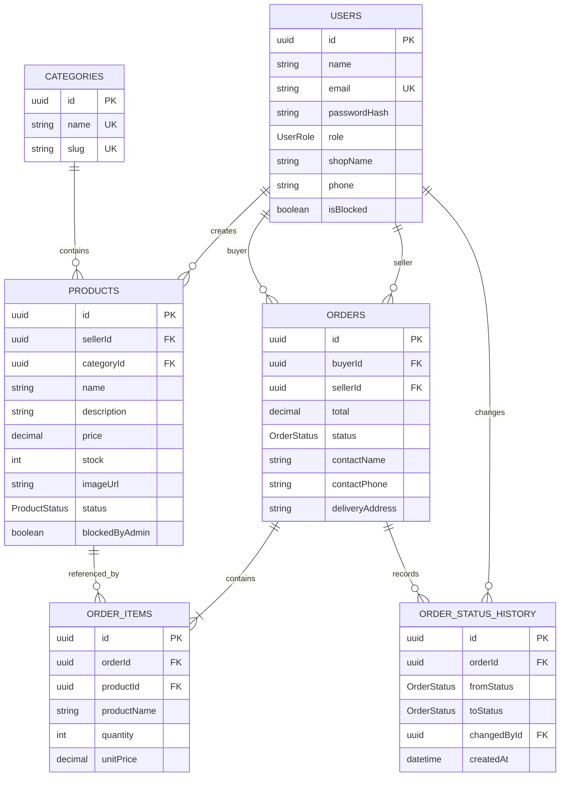

# HANDCRAFT — архитектура веб-платформы продажи изделий ручной работы

**Версия:** 2.0  
**Статус:** проектирование новой версии до начала реализации  
**Язык:** JavaScript  
**Стек:** React (Vite), Node.js, Express, PostgreSQL, Prisma  
**Валюта:** KZT

---

## 1. Назначение проекта

HANDCRAFT — веб-платформа, на которой мастера размещают изделия ручной работы, а покупатели находят товары и оформляют заказы. Администратор управляет доступом пользователей и скрывает товары, нарушающие правила платформы.

Главный сценарий: **мастер публикует товар → покупатель находит товар → добавляет его в корзину → оформляет заказ → мастер обрабатывает заказ и меняет его статус.**

Заказ оформляется без онлайн-оплаты. Покупатель указывает контактные данные и адрес, чтобы мастер мог связаться с ним и согласовать передачу товара.

Документ описывает план новой реализации. Старый прототип сохранён отдельно и не переносится в новую версию как готовая реализация.

## 2. Пользователи и права доступа

Права проверяются на сервере при каждом защищённом запросе.

| Возможность | Гость | Покупатель (`BUYER`) | Мастер (`SELLER`) | Администратор (`ADMIN`) |
|---|---:|---:|---:|---:|
| Просмотр опубликованного каталога | Да | Да | Да | Да |
| Поиск по названию и просмотр категорий | Да | Да | Да | Да |
| Оформление заказа | Нет | Да | Нет | Нет |
| Просмотр заказов | Нет | Только свои | Только относящиеся к его товарам | Все |
| Отмена заказа `NEW` | Нет | Только своего | Нет | Нет |
| Создание товара | Нет | Нет | Да | Нет |
| Редактирование товара | Нет | Нет | Только своего | Нет |
| Скрытие собственного товара | Нет | Нет | Только своего | Нет |
| Блокировка пользователей | Нет | Нет | Нет | Да |
| Административное скрытие товара | Нет | Нет | Нет | Да |

**Гость** просматривает опубликованный каталог, категории и карточки товаров, ищет товары, регистрируется и входит.

**Покупатель** управляет корзиной, оформляет заказы, просматривает только собственные заказы и может отменить только свой заказ со статусом `NEW`.

**Мастер** создаёт, редактирует и скрывает собственные товары. Он видит заказы, в которых указан продавцом, и меняет статусы по разрешённым переходам.

**Администратор** просматривает пользователей и товары, блокирует/разблокирует пользователей и скрывает товары за нарушение правил. Администратор не создаёт и не редактирует товары мастеров и не меняет статусы заказов в MVP.

Публичная регистрация разрешает только роли `BUYER` и `SELLER`. Роль `ADMIN` назначается отдельно и не может быть выбрана при регистрации.

## 3. MVP и пользовательские истории

MVP — минимальная версия, обеспечивающая основной сценарий продажи изделия от публикации до обработки заказа.

### 3.1. Функции MVP

1. Регистрация и вход покупателей и мастеров. Авторизация — JWT в заголовке `Authorization: Bearer <token>`.
2. Каталог: категории и поиск по названию. Без сортировки. Пагинация — 20 товаров на страницу.
3. Карточка товара: название, описание, цена, остаток, категория, мастер и одна фотография.
4. Кабинет мастера: создание, редактирование и скрытие собственных товаров. Одна фотография по ссылке или одним файлом.
5. Корзина и оформление заказа. В одной корзине товары только одного мастера. При попытке добавить товар другого мастера предлагается оформить текущий заказ или очистить корзину.
6. Заказы: покупатель видит свои заказы и отменяет `NEW`; мастер видит свои заказы и меняет статусы по таблице переходов.
7. Администрирование: блокировка/разблокировка пользователей и скрытие товаров. Категории задаются через `seed.js`.

При оформлении заказа сервер повторно проверяет товар, актуальную цену и остаток. Создание заказа, его позиций и уменьшение остатков выполняются в одной транзакции PostgreSQL.

### 3.2. Функции после MVP

| Функция | Причина переноса |
|---|---|
| Корзина с товарами разных мастеров и разделение на заказы | Усложняет оформление, обработку ошибок и транзакции |
| Несколько фотографий товара | Требует управления множеством файлов и их порядком |
| Сортировка каталога | Для первой версии достаточно категорий, поиска и пагинации |
| Управление категориями через админку | В MVP используется фиксированный набор из `seed.js` |
| Полноценная модерация с причинами и апелляциями | Для MVP достаточно скрытия товара |
| Исправление статусов заказа администратором | Не нужно для основного сценария |
| Автоматическая отмена неподтверждённых заказов | Требует фоновой задачи и обработки остатков |
| Онлайн-оплата, отзывы, избранное, чат и уведомления | Это отдельные функции, не нужные для проверки главного сценария |

**На будущее:** если мастер не подтвердил заказ в течение трёх дней, система может автоматически отменить его и вернуть остаток. Фоновая задача не входит в MVP.

### 3.3. Пользовательские истории

| ID | История | Приоритет |
|---|---|---|
| US-01 | Как посетитель, я хочу зарегистрироваться как покупатель или мастер | MVP |
| US-02 | Как пользователь, я хочу войти и получить данные профиля | MVP |
| US-03 | Как посетитель, я хочу просматривать каталог и категории | MVP |
| US-04 | Как посетитель, я хочу искать товары по названию | MVP |
| US-05 | Как покупатель, я хочу видеть карточку товара | MVP |
| US-06 | Как покупатель, я хочу добавлять товары одного мастера в корзину и менять количество | MVP |
| US-07 | Как покупатель, я хочу оформить заказ с контактами и адресом | MVP |
| US-08 | Как покупатель, я хочу просматривать свои заказы и статусы | MVP |
| US-09 | Как покупатель, я хочу отменить собственный новый заказ | MVP |
| US-10 | Как мастер, я хочу создавать товары с фотографией | MVP |
| US-11 | Как мастер, я хочу редактировать и скрывать свои товары | MVP |
| US-12 | Как мастер, я хочу просматривать и обрабатывать свои заказы | MVP |
| US-13 | Как администратор, я хочу блокировать и разблокировать пользователей | MVP |
| US-14 | Как администратор, я хочу скрывать товары, нарушающие правила | MVP |
| US-15 | Как покупатель, я хочу добавлять товары в избранное | После MVP |
| US-16 | Как покупатель, я хочу оставлять отзывы | После MVP |
| US-17 | Как покупатель или мастер, я хочу переписываться | После MVP |

## 4. Основные бизнес-правила

Правила проверяются на сервере. Проверки интерфейса не заменяют серверную валидацию.

| ID | Правило |
|---|---|
| BR-01 | Email пользователя должен быть уникальным. |
| BR-02 | В базе хранится хеш пароля, а не пароль в открытом виде. |
| BR-03 | При публичной регистрации нельзя назначить себе роль `ADMIN`. |
| BR-04 | Заблокированный пользователь не может выполнять защищённые действия. |
| BR-05 | Мастер изменяет только собственные товары. |
| BR-06 | В каталоге отображаются только `PUBLISHED` товары с `blockedByAdmin = false`. |
| BR-07 | Цена должна быть больше нуля; остаток — целое число не меньше нуля. |
| BR-08 | Каждый товар связан с существующей категорией и пользователем с ролью `SELLER`. |
| BR-09 | Товары физически не удаляются: используется статус `REMOVED`. |
| BR-10 | При оформлении сервер повторно проверяет статус, административную блокировку, цену и остаток. |
| BR-11 | Название товара и цена фиксируются в позиции заказа на момент покупки. |
| BR-12 | В MVP одна корзина содержит товары только одного мастера. |
| BR-13 | Создание заказа, позиций и уменьшение остатков выполняются в одной транзакции. При недостаточном остатке заказ не создаётся, возвращается `409 Conflict`. |
| BR-14 | Покупатель видит только собственные заказы и отменяет только свои заказы `NEW`. |
| BR-15 | Мастер видит только заказы, в которых он указан продавцом. |
| BR-16 | `COMPLETED` и `CANCELLED` — конечные статусы. |
| BR-17 | При отмене `NEW` остаток возвращается только один раз; статус, возврат и запись истории выполняются в одной транзакции. |
| BR-18 | Категории MVP задаются через `seed.js`; API для их создания и удаления нет. |
| BR-19 | Нельзя заблокировать последнего действующего администратора. |
| BR-20 | Телефон нормализуется сервером к `+7XXXXXXXXXX`; ввод `8 701...` преобразуется к этому формату, некорректный номер отклоняется. |
| BR-21 | Если администратор заблокировал товар, мастер не может самостоятельно вернуть его в каталог. |

### 4.1. Статусы товара

| Статус | Значение |
|---|---|
| `PUBLISHED` | Товар опубликован мастером и доступен в каталоге, если не заблокирован администратором. |
| `HIDDEN` | Мастер самостоятельно скрыл товар. |
| `REMOVED` | Мастер снял товар с публикации. Запись остаётся в БД для сохранения истории заказов. |

Поле `blockedByAdmin Boolean` хранит административную блокировку. Если оно равно `true`, товар не отображается в каталоге независимо от статуса. Мастер не может менять это поле. Редактирование товара мастером не снимает блокировку.

### 4.2. Статусы заказа и переходы

| Статус | Значение |
|---|---|
| `NEW` | Заказ создан и ожидает подтверждения мастером. |
| `CONFIRMED` | Мастер подтвердил заказ. |
| `PROCESSING` | Мастер готовит заказ. |
| `SHIPPED` | Заказ передан покупателю или в доставку. |
| `COMPLETED` | Заказ выполнен. |
| `CANCELLED` | Заказ отменён. |

Разрешённые переходы MVP:

| Из | В | Кто |
|---|---|---|
| `NEW` | `CONFIRMED` | Мастер этого заказа |
| `NEW` | `CANCELLED` | Покупатель-владелец заказа |
| `CONFIRMED` | `PROCESSING` | Мастер этого заказа |
| `PROCESSING` | `SHIPPED` | Мастер этого заказа |
| `SHIPPED` | `COMPLETED` | Мастер этого заказа |

Другие переходы запрещены. Мастер не отменяет заказ через обычное изменение статуса. Покупатель не отменяет заказ после `NEW`. Административное исправление статусов не входит в MVP.

Каждый успешный переход записывается в `order_status_history`: заказ, предыдущий статус, новый статус, пользователь и время изменения. При создании заказа записывается начальное событие `NULL → NEW`.

При отмене сервер проверяет владельца и статус `NEW`, переводит заказ в `CANCELLED`, возвращает остатки и записывает историю в одной транзакции. Повторная отмена не увеличивает остаток повторно.

## 5. База данных

Используется PostgreSQL. Prisma — ORM; модели описываются в `schema.prisma`, изменения оформляются миграциями. Идентификаторы — UUID, деньги — `Decimal @db.Decimal(12, 2)`, валюта — KZT.

### 5.1. Таблицы

#### `users` — пользователи

| Поле | Тип | Назначение |
|---|---|---|
| `id` | `String @id @default(uuid()) @db.Uuid` | Первичный ключ |
| `name` | `String` | Имя |
| `email` | `String @unique` | Уникальный email |
| `passwordHash` | `String` | Хеш пароля |
| `role` | `UserRole` | `BUYER`, `SELLER`, `ADMIN` |
| `shopName` | `String?` | Название мастерской |
| `phone` | `String?` | Нормализованный телефон |
| `isBlocked` | `Boolean @default(false)` | Блокировка |
| `createdAt` | `DateTime @default(now())` | Дата создания |
| `updatedAt` | `DateTime @updatedAt` | Дата изменения |

#### `categories` — категории

| Поле | Тип | Назначение |
|---|---|---|
| `id` | `String @id @default(uuid()) @db.Uuid` | Первичный ключ |
| `name` | `String @unique` | Название |
| `slug` | `String @unique` | Короткое имя URL |
| `description` | `String?` | Описание |
| `createdAt` | `DateTime @default(now())` | Дата создания |

Категории создаются через `seed.js`. API для создания, изменения и удаления категорий в MVP отсутствует.

#### `products` — товары

| Поле | Тип | Назначение |
|---|---|---|
| `id` | `String @id @default(uuid()) @db.Uuid` | Первичный ключ |
| `sellerId` | `String @db.Uuid` | Внешний ключ на `users.id` |
| `categoryId` | `String @db.Uuid` | Внешний ключ на `categories.id` |
| `name` | `String` | Название |
| `description` | `String` | Описание |
| `price` | `Decimal @db.Decimal(12, 2)` | Цена в тенге |
| `stock` | `Int` | Остаток |
| `imageUrl` | `String?` | Ссылка или путь к одной фотографии |
| `status` | `ProductStatus @default(HIDDEN)` | `PUBLISHED`, `HIDDEN`, `REMOVED` |
| `blockedByAdmin` | `Boolean @default(false)` | Административная блокировка |
| `createdAt` | `DateTime @default(now())` | Дата создания |
| `updatedAt` | `DateTime @updatedAt` | Дата изменения |

В MVP у товара одна фотография. Отдельная таблица фотографий не нужна.

#### `orders` — заказы

Одна запись представляет заказ одного покупателя одному мастеру. В MVP товары в корзине принадлежат одному мастеру, поэтому создаётся один заказ.

| Поле | Тип | Назначение |
|---|---|---|
| `id` | `String @id @default(uuid()) @db.Uuid` | Первичный ключ |
| `buyerId` | `String @db.Uuid` | Покупатель, FK на `users.id` |
| `sellerId` | `String @db.Uuid` | Мастер, FK на `users.id` |
| `total` | `Decimal @db.Decimal(12, 2)` | Итоговая сумма |
| `status` | `OrderStatus @default(NEW)` | Текущий статус |
| `contactName` | `String` | Имя получателя на момент заказа |
| `contactPhone` | `String` | Телефон на момент заказа |
| `deliveryAddress` | `String` | Адрес на момент заказа |
| `comment` | `String?` | Комментарий |
| `createdAt` | `DateTime @default(now())` | Дата оформления |
| `updatedAt` | `DateTime @updatedAt` | Дата изменения |

#### `order_items` — позиции заказа

| Поле | Тип | Назначение |
|---|---|---|
| `id` | `String @id @default(uuid()) @db.Uuid` | Первичный ключ |
| `orderId` | `String @db.Uuid` | Внешний ключ на заказ |
| `productId` | `String @db.Uuid` | Обязательная ссылка на товар |
| `productName` | `String` | Название на момент покупки |
| `quantity` | `Int` | Количество |
| `unitPrice` | `Decimal @db.Decimal(12, 2)` | Цена единицы на момент покупки |

Товары физически не удаляются, а получают статус `REMOVED`. Поэтому `productId` обязателен. Название и цена сохраняются в позиции заказа, чтобы история покупки не менялась при редактировании карточки товара.

#### `order_status_history` — история статусов

| Поле | Тип | Назначение |
|---|---|---|
| `id` | `String @id @default(uuid()) @db.Uuid` | Первичный ключ |
| `orderId` | `String @db.Uuid` | Внешний ключ на заказ |
| `fromStatus` | `OrderStatus?` | Предыдущий статус; `NULL` при создании |
| `toStatus` | `OrderStatus` | Новый статус |
| `changedById` | `String @db.Uuid` | Пользователь, выполнивший переход |
| `createdAt` | `DateTime @default(now())` | Дата и время |

При создании заказа записывается `NULL → NEW`. При каждом успешном переходе создаётся новая запись. История не редактируется обычными пользователями.

### 5.2. Перечисления

- `UserRole`: `BUYER`, `SELLER`, `ADMIN`.
- `ProductStatus`: `PUBLISHED`, `HIDDEN`, `REMOVED`.
- `OrderStatus`: `NEW`, `CONFIRMED`, `PROCESSING`, `SHIPPED`, `COMPLETED`, `CANCELLED`.

### 5.3. Связи между таблицами

- `users` 1:N `products` по `sellerId`.
- `categories` 1:N `products`.
- `users` 1:N `orders` по `buyerId`.
- `users` 1:N `orders` по `sellerId`.
- `orders` 1:N `order_items`.
- `products` 1:N `order_items`.
- `orders` 1:N `order_status_history`.
- `users` 1:N `order_status_history` по `changedById`.

### 5.4. ER-диаграмма



### 5.5. Почему выбраны эти сущности

`users` хранит общие данные аккаунтов и роль. `products` связана с владельцем и категорией. `orders` хранит сведения о покупке, `order_items` — состав заказа и цену на момент покупки. `order_status_history` позволяет установить, кто и когда изменил статус.

Корзина MVP хранится на стороне клиента. При оформлении сервер заново получает актуальные значения из PostgreSQL и не доверяет цене, названию, продавцу или остатку, переданным клиентом.

## 6. API — взаимодействие клиента и сервера

Frontend обращается к backend через REST API Express. Общий префикс — `/api`. Данные передаются в JSON. Защищённые запросы содержат `Authorization: Bearer <JWT>`.

### 6.1. Авторизация

| Метод и endpoint | Доступ | Запрос | Ответ | История |
|---|---|---|---|---|
| `POST /api/auth/register` | Гость | `{ "name":"Анна", "email":"anna@example.com", "password":"secret123", "role":"BUYER" }` | `201`: пользователь и JWT | US-01 |
| `POST /api/auth/login` | Гость | `{ "email":"anna@example.com", "password":"secret123" }` | `200`: пользователь и JWT | US-02 |
| `GET /api/auth/me` | Авторизованный | Без тела | `200`: текущий пользователь без пароля | US-02 |

При регистрации сервер проверяет уникальность email и допустимость роли. Пароль хешируется. Пароль и `passwordHash` никогда не возвращаются. Выход в MVP выполняется удалением JWT на клиенте.

### 6.2. Категории и каталог

| Метод и endpoint | Доступ | Запрос | Ответ | История |
|---|---|---|---|---|
| `GET /api/categories` | Все | Без параметров | `200`: массив категорий | US-03 |
| `GET /api/products` | Все | `q`, `category`, `page`, `limit` | `200`: `{ "items": [], "page":1, "limit":20, "total":0, "pages":0 }` | US-03, US-04 |
| `GET /api/products/:id` | Все с учётом видимости | ID товара в URL | `200`: карточка товара | US-05 |

Для каталога: `q` — поиск по названию; `category` — категория; `page` — номер страницы от 1; `limit` — максимум 20. Сортировки в MVP нет. Возвращаются только `PUBLISHED` товары с `blockedByAdmin = false`.

### 6.3. Товары мастера

| Метод и endpoint | Доступ | Запрос | Ответ | История |
|---|---|---|---|---|
| `GET /api/seller/products` | Мастер | Без тела | `200`: товары текущего мастера | US-11 |
| `POST /api/seller/products` | Мастер | `{ "name":"Чашка", "description":"Ручная работа", "price":5000, "stock":3, "categoryId":"uuid", "imageUrl":"https://example.com/cup.jpg" }` | `201`: созданный товар | US-10 |
| `PUT /api/seller/products/:id` | Мастер-владелец | Поля товара для изменения | `200`: обновлённый товар | US-11 |
| `PATCH /api/seller/products/:id/status` | Мастер-владелец | `{ "status":"HIDDEN" }` или `{ "status":"PUBLISHED" }` | `200`: обновлённый товар | US-11 |

Мастер меняет только собственные товары. Если `blockedByAdmin = true`, мастер не может установить `PUBLISHED`. Физическое удаление отсутствует; для снятия с публикации используется `REMOVED`. В MVP доступна одна фотография — URL или один файл.

### 6.4. Администрирование

| Метод и endpoint | Доступ | Запрос | Ответ | История |
|---|---|---|---|---|
| `GET /api/admin/users` | Администратор | Параметры пагинации | `200`: список пользователей без паролей | US-13 |
| `PATCH /api/admin/users/:id/block` | Администратор | `{ "isBlocked":true }` или `{ "isBlocked":false }` | `200`: ID и состояние блокировки | US-13 |
| `GET /api/admin/products` | Администратор | Параметры пагинации | `200`: список товаров | US-14 |
| `PATCH /api/admin/products/:id/moderation` | Администратор | `{ "blockedByAdmin":true }` или `{ "blockedByAdmin":false }` | `200`: обновлённый товар | US-14 |

Административная блокировка устанавливает `blockedByAdmin = true`. Только администратор может снять её. API создания, редактирования и удаления категорий в MVP отсутствует.

### 6.5. Корзина и заказы

| Метод и endpoint | Доступ | Запрос | Ответ | История |
|---|---|---|---|---|
| `POST /api/orders` | Покупатель | Массив `{ "productId":"uuid", "quantity":2 }` и контактные данные | `201`: созданный заказ и позиции, статус `NEW` | US-06, US-07 |
| `GET /api/orders/my` | Покупатель | Параметры пагинации | `200`: собственные заказы | US-08 |
| `GET /api/seller/orders` | Мастер | Параметры пагинации | `200`: заказы текущего мастера | US-12 |
| `GET /api/orders/:id` | Покупатель-владелец или мастер этого заказа | ID заказа | `200`: заказ, позиции, статус | US-08, US-12 |
| `PATCH /api/orders/:id/status` | Мастер этого заказа | `{ "status":"CONFIRMED" }` и другие разрешённые переходы | `200`: заказ с новым статусом | US-12 |
| `POST /api/orders/:id/cancel` | Покупатель-владелец | Без тела | `200`: заказ `CANCELLED` | US-09 |

`POST /api/orders` принимает только `productId`, `quantity` и контактные данные. Название, цена, продавец и сумма рассчитываются сервером. Все товары должны принадлежать одному мастеру; иначе возвращается `400 Bad Request`.

### 6.6. Примеры ответов основных API

**Регистрация — `POST /api/auth/register`, HTTP 201**

```json
{
  "user": {
    "id": "b8f4a4b0-1111-4444-8888-123456789abc",
    "name": "Анна",
    "email": "anna@example.com",
    "role": "BUYER"
  },
  "token": "jwt-token"
}
```

**Каталог — `GET /api/products?page=1&limit=20`, HTTP 200**

```json
{
  "items": [
    {
      "id": "d9f4a4b0-1111-4444-8888-123456789abc",
      "name": "Керамическая чашка",
      "description": "Чашка ручной работы",
      "price": "5000.00",
      "stock": 3,
      "imageUrl": "https://example.com/cup.jpg",
      "category": { "id": "c9f4a4b0-1111-4444-8888-123456789abc", "name": "Керамика" },
      "seller": { "id": "a9f4a4b0-1111-4444-8888-123456789abc", "shopName": "Мастерская Анны" }
    }
  ],
  "page": 1,
  "limit": 20,
  "total": 1,
  "pages": 1
}
```

**Создание товара — `POST /api/seller/products`, HTTP 201**

```json
{
  "id": "d9f4a4b0-1111-4444-8888-123456789abc",
  "name": "Керамическая чашка",
  "price": "5000.00",
  "stock": 3,
  "status": "HIDDEN",
  "blockedByAdmin": false,
  "imageUrl": "https://example.com/cup.jpg"
}
```

**Оформление заказа — `POST /api/orders`, HTTP 201**

```json
{
  "id": "e9f4a4b0-1111-4444-8888-123456789abc",
  "status": "NEW",
  "total": "10000.00",
  "contactName": "Анна",
  "contactPhone": "+77011234567",
  "deliveryAddress": "Алматы, пример адреса",
  "items": [
    {
      "productId": "d9f4a4b0-1111-4444-8888-123456789abc",
      "productName": "Керамическая чашка",
      "quantity": 2,
      "unitPrice": "5000.00"
    }
  ]
}
```

**Недостаточный остаток — HTTP 409**

```json
{
  "error": {
    "code": "INSUFFICIENT_STOCK",
    "message": "Недостаточно товара на складе"
  }
}
```

**Изменение статуса — `PATCH /api/orders/:id/status`, HTTP 200**

```json
{
  "id": "e9f4a4b0-1111-4444-8888-123456789abc",
  "status": "CONFIRMED",
  "updatedAt": "2026-11-18T10:00:00.000Z"
}
```

### 6.7. Общие ошибки API

| HTTP | Значение | Пример |
|---|---|---|
| `400` | Неверные данные | Некорректное поле или товары разных мастеров |
| `401` | Нет авторизации | JWT отсутствует или недействителен |
| `403` | Нет прав | Мастер изменяет чужой товар |
| `404` | Объект не найден или недоступен | Товар или заказ отсутствует |
| `409` | Конфликт | Недостаточный остаток или недопустимый переход |
| `500` | Ошибка сервера | Непредвиденная ошибка |

## 7. Архитектура приложения и структура проекта

Приложение разделено на frontend и backend. Это позволяет независимо разрабатывать интерфейс и серверную бизнес-логику.

### 7.1. Карта страниц и URL

| Страница | URL | Доступ | Назначение |
|---|---|---|---|
| Главная / каталог | `/` | Все | Просмотр опубликованных товаров |
| Категория | `/categories/:slug` | Все | Товары категории |
| Карточка товара | `/products/:id` | Все с учётом видимости | Информация о товаре |
| Регистрация | `/register` | Гость | Создание аккаунта |
| Вход | `/login` | Гость | Авторизация |
| Корзина | `/cart` | Покупатель | Просмотр корзины |
| Оформление заказа | `/checkout` | Покупатель | Контакты и создание заказа |
| Мои заказы | `/account/orders` | Покупатель | История заказов |
| Заказ покупателя | `/account/orders/:id` | Покупатель-владелец | Детали заказа |
| Товары мастера | `/seller/products` | Мастер | Собственные товары |
| Создание товара | `/seller/products/new` | Мастер | Форма товара |
| Редактирование товара | `/seller/products/:id/edit` | Мастер-владелец | Изменение товара |
| Заказы мастера | `/seller/orders` | Мастер | Заказы по его товарам |
| Заказ мастера | `/seller/orders/:id` | Мастер этого заказа | Обработка заказа |
| Пользователи | `/admin/users` | Администратор | Блокировка пользователей |
| Товары для модерации | `/admin/products` | Администратор | Просмотр и скрытие товаров |

Это URL страниц frontend. API backend описан в разделе 6.

### 7.2. Frontend

React отвечает за страницы, компоненты, формы и взаимодействие с API. Vite используется для запуска сервера разработки и сборки frontend. Клиент передаёт JWT в заголовке `Authorization`. Скрытие элементов интерфейса по роли не заменяет проверку прав на сервере.

### 7.3. Backend

Node.js запускает сервер, Express обрабатывает HTTP-запросы, Prisma взаимодействует с PostgreSQL.

Путь запроса: `routes → middleware → controllers → services → Prisma → PostgreSQL`.

- **routes** — объявляют URL, HTTP-метод и middleware.
- **middleware** — проверяют JWT и роль.
- **controllers** — принимают запрос и формируют HTTP-ответ.
- **services** — реализуют бизнес-правила и операции.
- **Prisma** — выполняет запросы и транзакции к PostgreSQL.

### 7.4. Структура каталогов

```text
HANDCRAFT/
├── client/
│   ├── src/
│   │   ├── components/
│   │   ├── pages/
│   │   ├── services/
│   │   ├── hooks/
│   │   ├── context/
│   │   └── App.jsx
│   ├── index.html
│   └── package.json
├── server/
│   ├── src/
│   │   ├── routes/
│   │   ├── controllers/
│   │   ├── services/
│   │   ├── middleware/
│   │   ├── validators/
│   │   ├── database/
│   │   └── app.js
│   ├── prisma/
│   │   ├── schema.prisma
│   │   └── seed.js
│   ├── uploads/
│   └── package.json
├── docs/
│   ├── architecture.md
│   ├── competitors.md
│   └── spec.md
├── .env.example
├── .gitignore
└── README.md
```

Структура уточняется во время реализации, но разделение frontend, backend и слоёв серверной логики сохраняется.

## 8. Безопасность и проверка данных

1. Пароли хранятся только в виде хеша (bcrypt/bcryptjs).
2. Авторизация выполняется сервером с помощью JWT в заголовке `Authorization`.
3. Публичная регистрация разрешает только `BUYER` и `SELLER`; роль `ADMIN` нельзя назначить клиентским запросом.
4. Защищённые маршруты используют middleware авторизации и проверки роли.
5. Сервер проверяет владельца товара или заказа, а не доверяет ID от клиента.
6. Входные данные проверяются до операций с БД.
7. Секреты и строка подключения хранятся в `.env`, который не добавляется в Git.
8. Для Express настраиваются безопасные HTTP-заголовки, ограничение частоты запросов и CORS для разрешённого frontend.
9. Для фотографии ограничиваются размер и форматы, проверяется фактический тип файла.
10. Телефон нормализуется сервером к `+7XXXXXXXXXX`.
11. Изменение остатков и отмена заказа выполняются транзакционно.
12. JWT имеет ограниченный срок действия; при выходе клиент удаляет токен.

В MVP применяется JWT в заголовке `Authorization`, поэтому cookie/CSRF-схема не используется.

## 9. Ключевые технические сценарии

### 9.1. Два покупателя одновременно заказывают последний товар

Если остаток равен 1, два покупателя почти одновременно отправляют запросы. Сервер выполняет проверку и уменьшение остатка внутри транзакции. Уменьшение должно быть условным: остаток меняется только если его достаточно. Одна операция резервирует последнюю единицу. Вторая не может уменьшить остаток ниже нуля, её заказ не создаётся, API возвращает `409 Conflict`. Это обеспечивает BR-10 и BR-13.

### 9.2. Администратор скрыл товар

Администратор устанавливает `blockedByAdmin = true`. Товар исчезает из публичного каталога. Мастер не может сбросить это поле или вернуть товар в каталог самостоятельно.

### 9.3. Почему в MVP корзина ограничена одним мастером

Ограничение упрощает создание заказа: один заказ относится к одному продавцу. Не нужно делить корзину на несколько заказов и обрабатывать частичный успех для разных продавцов. После MVP сервис оформления можно расширить: группировать позиции по `sellerId` и создавать несколько заказов в общей транзакции. Текущие связи `orders`, `order_items`, `buyerId` и `sellerId` позволяют такое расширение.

### 9.4. Зачем хранить название и цену в `order_items`

Название и цена могут измениться после покупки. `productName` и `unitPrice` сохраняют значения на момент оформления, поэтому история заказа и итоговая сумма остаются корректными.

## 10. Критерии готовности MVP

- Покупатель и мастер могут зарегистрироваться и войти.
- Гость может просматривать категории и опубликованный каталог, искать по названию.
- Мастер может создать, изменить и скрыть свой товар с одной фотографией.
- Покупатель может добавить в корзину товары одного мастера и оформить заказ.
- Сервер проверяет актуальные цены и остатки.
- При одновременной покупке последней единицы не возникает отрицательного остатка и создаётся не более одного успешного заказа на эту единицу.
- Покупатель видит свои заказы и отменяет `NEW`.
- Мастер видит свои заказы и выполняет разрешённые переходы.
- История статусов сохраняет пользователя, дату и переход.
- Администратор блокирует пользователей и скрывает товары.
- Мастер не может самостоятельно вернуть административно заблокированный товар в каталог.

## 11. Возможное развитие после MVP

После проверки основного сценария можно добавить корзину с товарами разных мастеров, несколько фотографий, сортировку, управление категориями, расширенную модерацию, административное исправление статусов, избранное, отзывы, чат, уведомления и онлайн-оплату. Эти функции потребуют дополнительных бизнес-правил, экранов, таблиц и API.

## 12. Вопросы для защиты

**1. Назови главный сценарий проекта.**  
Мастер публикует товар, покупатель находит его, добавляет в корзину и оформляет заказ, после чего мастер обрабатывает заказ и меняет статус.

**2. Два покупателя одновременно заказывают последнюю вазу. Что произойдёт?**  
Сервер проверяет остаток и уменьшает его внутри транзакции. Только одна операция резервирует последнюю единицу. Второй покупатель получает `409 Conflict`, заказ не создаётся. Это обеспечивается BR-13.

**3. Почему корзина ограничена одним мастером?**  
Так проще реализовать и проверить MVP: один заказ относится к одному продавцу. Позже корзину можно группировать по `sellerId` и создавать отдельные заказы.

**4. Администратор скрыл товар. Может ли мастер вернуть его?**  
Нет. Администратор устанавливает `blockedByAdmin = true`. Мастер не имеет права менять это поле.

**5. Зачем `order_items` хранит название и цену?**  
Они могут измениться после покупки. В заказе остаются значения на момент оформления.

**6. Почему заказ и уменьшение остатков выполняются в одной транзакции?**  
Чтобы заказ и складские остатки изменялись согласованно: не возникало заказа без списания остатка или списания без созданного заказа.

## Заключение

Архитектура HANDCRAFT описывает MVP маркетплейса изделий ручной работы на React, Node.js, Express, PostgreSQL и Prisma. Определены роли и права доступа, семь функций MVP, пользовательские истории, бизнес-правила, статусы и переходы заказов, структура БД, ER-диаграмма, API, карта страниц, безопасность и критерии готовности.

Главный критерий готовности MVP — покупатель может оформить заказ на опубликованный товар, а соответствующий мастер может увидеть и обработать этот заказ, не получая доступ к данным других мастеров и покупателей.
