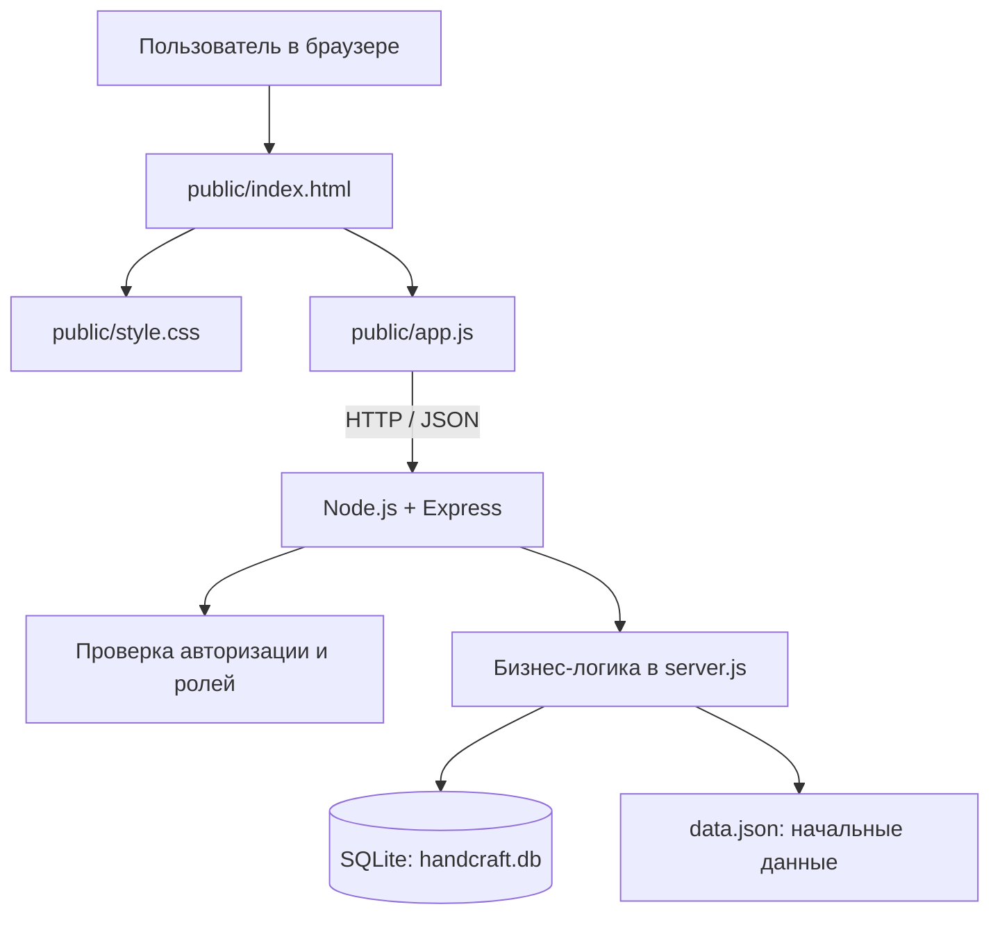
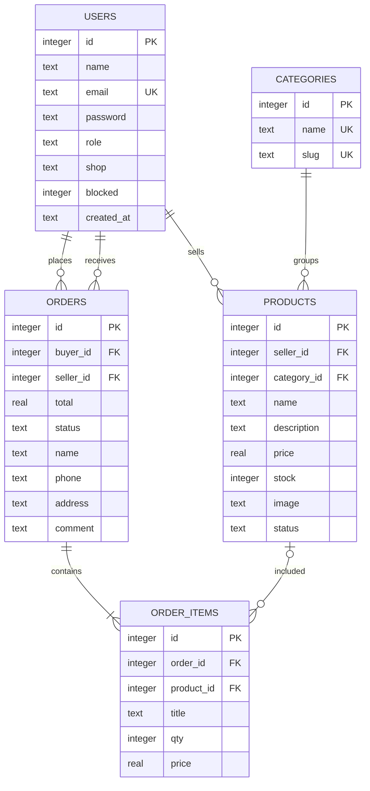

# Архитектура проекта HANDCRAFT

**Проект:** HANDCRAFT — веб-платформа для продажи изделий ручной работы  
**Документ:** архитектура текущей версии проекта  
**Основание:** анализ исходного архива проекта HANDCRAFT.

> Важно: этот документ описывает именно код, который сейчас находится в проекте. В текущей реализации используются HTML, CSS, JavaScript, Express и SQLite. React, Vite, PostgreSQL и Prisma указаны в техническом задании как целевой стек, но в загруженном коде пока не реализованы.

## 1. Назначение и общая схема

HANDCRAFT — веб-платформа, где мастера размещают изделия ручной работы, покупатели выбирают товары и оформляют заказы без онлайн-оплаты, а администратор управляет пользователями, товарами и категориями.

Приложение построено как единое веб-приложение:
- браузер отображает интерфейс из папки `public`;
- JavaScript в браузере отправляет HTTP-запросы к API;
- Express обрабатывает запросы и выполняет бизнес-логику;
- SQLite хранит пользователей, товары, категории и заказы.



## 2. Технологии текущей реализации

| Часть | Технология | Назначение |
|---|---|---|
| Интерфейс | HTML | Структура страниц |
| Оформление | CSS | Внешний вид и адаптивность |
| Логика браузера | JavaScript | Навигация, корзина, формы, запросы к API |
| Сервер | Node.js | Выполнение серверного JavaScript |
| HTTP-сервер | Express 4 | API и раздача статических файлов |
| База данных | SQLite (`node:sqlite`) | Хранение данных |
| Пароли | bcryptjs | Хеширование паролей |
| Авторизация | jsonwebtoken + cookie-parser | JWT в HttpOnly cookie |
| Защитные HTTP-заголовки | Helmet | Базовые настройки безопасности |
| Начальные данные | data.json | Тестовые пользователи, категории и товары |

Проект требует Node.js версии 22.13 или новее, поскольку используется встроенный модуль `node:sqlite`.

## 3. Роли пользователей

В коде используются следующие значения поля `users.role`:

### 3.1. Покупатель (`buyer`)
- регистрируется и входит в аккаунт;
- просматривает каталог и карточки товаров;
- добавляет товары в корзину;
- оформляет заказ;
- просматривает собственные заказы;
- может отменить собственный новый заказ.

### 3.2. Мастер / продавец (`seller`)
- регистрируется с названием мастерской;
- добавляет товары;
- редактирует собственные товары;
- скрывает и публикует свои товары;
- просматривает заказы, относящиеся к его товарам;
- меняет статусы таких заказов.

### 3.3. Администратор (`admin`)
- просматривает статистику;
- просматривает пользователей;
- блокирует и разблокирует покупателей и мастеров;
- просматривает товары;
- управляет категориями;
- имеет доступ к административным операциям.

Обычная регистрация не позволяет выбрать роль `admin`: сервер выбирает только `seller` или `buyer`.

## 4. Основные пользовательские сценарии

1. Гость открывает каталог и просматривает товары.
2. Гость регистрируется как покупатель или мастер.
3. Покупатель добавляет товары в корзину.
4. Корзина хранится в `localStorage` браузера.
5. Покупатель вводит имя, телефон, адрес и комментарий.
6. Сервер проверяет наличие товаров и создаёт заказы.
7. Если товары принадлежат разным мастерам, сервер создаёт отдельный заказ для каждого мастера.
8. Мастер видит только заказы, относящиеся к его товарам.
9. Мастер меняет статус заказа.
10. Покупатель может отменить заказ, пока он имеет статус `new`.
11. При отмене заказа количество товаров возвращается на склад.
12. Администратор управляет пользователями, товарами и категориями.

## 5. Структура проекта

```text
HANDCRAFT/
├── docs/
│   ├── architecture.md
│   ├── competitors.md
│   └── spec.md
├── public/
│   ├── index.html
│   ├── style.css
│   └── app.js
├── data.json
├── server.js
├── package.json
├── package-lock.json
├── .gitignore
└── README.md
```

### Назначение файлов и папок

| Путь | Ответственность |
|---|---|
| `server.js` | Express-приложение, API, подключение SQLite, создание таблиц, авторизация и бизнес-логика |
| `data.json` | Начальные тестовые данные |
| `public/index.html` | HTML-каркас сайта |
| `public/style.css` | Стили сайта |
| `public/app.js` | Интерфейс, маршрутизация по hash, корзина, формы и вызовы API |
| `docs/spec.md` | Техническое задание |
| `docs/competitors.md` | Анализ конкурентов |
| `docs/architecture.md` | Архитектура текущей реализации |
| `package.json` | Зависимости и команды запуска |
| `package-lock.json` | Зафиксированные версии зависимостей |
| `.gitignore` | Файлы, которые Git не должен добавлять в репозиторий |

В текущей версии серверная логика находится преимущественно в одном файле `server.js`. Это удобно для небольшого учебного прототипа, но при расширении проекта файл стоит разделить на маршруты, контроллеры, сервисы и работу с базой данных.

## 6. База данных

Сейчас используется SQLite. База создаётся автоматически при запуске сервера в файле `handcraft.db`. Таблицы создаются через `CREATE TABLE IF NOT EXISTS`.

### 6.1. Таблица `users`

| Поле | Тип SQLite | Назначение |
|---|---|---|
| `id` | INTEGER PRIMARY KEY | Идентификатор пользователя |
| `name` | TEXT | Имя |
| `email` | TEXT UNIQUE | Электронная почта |
| `password` | TEXT | Хеш пароля |
| `role` | TEXT | `buyer`, `seller` или `admin` |
| `shop` | TEXT | Название мастерской продавца |
| `blocked` | INTEGER | Признак блокировки |
| `created_at` | TEXT | Дата регистрации |

### 6.2. Таблица `categories`

| Поле | Тип SQLite | Назначение |
|---|---|---|
| `id` | INTEGER PRIMARY KEY | Идентификатор категории |
| `name` | TEXT UNIQUE | Название |
| `slug` | TEXT UNIQUE | Короткое имя для фильтрации |

### 6.3. Таблица `products`

| Поле | Тип SQLite | Назначение |
|---|---|---|
| `id` | INTEGER PRIMARY KEY | Идентификатор товара |
| `seller_id` | INTEGER | Ссылка на пользователя-продавца |
| `category_id` | INTEGER | Ссылка на категорию |
| `name` | TEXT | Название |
| `description` | TEXT | Описание |
| `price` | REAL | Цена |
| `stock` | INTEGER | Остаток |
| `image` | TEXT | URL одной фотографии |
| `status` | TEXT | `published` или `hidden` |
| `created_at` | TEXT | Дата создания |

### 6.4. Таблица `orders`

| Поле | Тип SQLite | Назначение |
|---|---|---|
| `id` | INTEGER PRIMARY KEY | Идентификатор заказа |
| `buyer_id` | INTEGER | Покупатель |
| `seller_id` | INTEGER | Мастер, которому предназначен заказ |
| `total` | REAL | Общая стоимость |
| `status` | TEXT | Статус заказа |
| `name` | TEXT | Имя получателя |
| `phone` | TEXT | Телефон |
| `address` | TEXT | Адрес доставки |
| `comment` | TEXT | Комментарий |
| `created_at` | TEXT | Дата оформления |

### 6.5. Таблица `order_items`

| Поле | Тип SQLite | Назначение |
|---|---|---|
| `id` | INTEGER PRIMARY KEY | Идентификатор позиции |
| `order_id` | INTEGER | Ссылка на заказ |
| `product_id` | INTEGER | Ссылка на товар; может стать NULL после удаления товара |
| `title` | TEXT | Название товара на момент покупки |
| `qty` | INTEGER | Количество |
| `price` | REAL | Цена на момент покупки |

### 6.6. Связи таблиц

- `users` 1:N `products`: один мастер может разместить много товаров.
- `categories` 1:N `products`: в одной категории может быть много товаров.
- `users` 1:N `orders` по `buyer_id`: покупатель может оформить много заказов.
- `users` 1:N `orders` по `seller_id`: мастер может получить много заказов.
- `orders` 1:N `order_items`: один заказ содержит несколько позиций.
- `products` 1:N `order_items`: один товар может встречаться в разных заказах.



`title` и `price` в `order_items` сохраняют сведения о товаре на момент покупки. Поэтому изменение названия или цены товара в каталоге не должно менять уже оформленный заказ.

## 7. API текущей реализации

Все маршруты начинаются с `/api`. Формат передачи данных — JSON.

| Метод | Маршрут | Назначение | Доступ |
|---|---|---|---|
| POST | `/api/register` | Регистрация | Гость |
| POST | `/api/login` | Вход | Гость |
| POST | `/api/logout` | Выход | Все |
| GET | `/api/me` | Текущий пользователь | Все |
| GET | `/api/categories` | Список категорий | Все |
| POST | `/api/categories` | Создание категории | ADMIN |
| DELETE | `/api/categories/:id` | Удаление категории, если в ней нет товаров | ADMIN |
| GET | `/api/products` | Каталог, поиск, категория и сортировка | Все |
| GET | `/api/products/:id` | Карточка товара | Все с проверкой скрытого товара |
| GET | `/api/my/products` | Товары текущего мастера | SELLER |
| POST | `/api/products` | Создание товара | SELLER или ADMIN |
| PUT | `/api/products/:id` | Редактирование товара | Владелец или ADMIN |
| PATCH | `/api/products/:id/status` | Скрытие или публикация товара | Владелец или ADMIN |
| DELETE | `/api/products/:id` | Удаление товара | Владелец или ADMIN |
| POST | `/api/orders` | Оформление заказа | BUYER |
| GET | `/api/orders` | Заказы текущего пользователя в зависимости от роли | Авторизованный |
| PATCH | `/api/orders/:id` | Изменение статуса или отмена заказа | Владелец заказа по правилам роли |
| GET | `/api/admin/stats` | Статистика платформы | ADMIN |
| GET | `/api/admin/users` | Список пользователей | ADMIN |
| PATCH | `/api/admin/users/:id` | Блокировка или разблокировка | ADMIN |
| GET | `/api/admin/products` | Все товары | ADMIN |

## 8. Авторизация и безопасность

1. При регистрации пароль хешируется через `bcryptjs`.
2. При входе пароль сравнивается с сохранённым хешем.
3. После входа сервер создаёт JWT.
4. JWT помещается в cookie с флагом `HttpOnly` и `SameSite=Lax`.
5. Middleware `auth` проверяет cookie и пользователя.
6. Middleware `onlyRoles` ограничивает доступ по роли.
7. Для товаров дополнительно проверяется, что текущий мастер является владельцем товара.
8. Для заказов сервер возвращает покупателю его заказы, мастеру — заказы его товаров, администратору — все заказы.
9. Helmet устанавливает защитные HTTP-заголовки.

**Замечание для публикации:** в `server.js` есть запасной секрет JWT, предназначенный только для локальной разработки. Для публичного или размещённого проекта нужно задать `JWT_SECRET` через переменные окружения и не использовать тестовый секрет.

## 9. Как работает корзина и оформление заказа

- Корзина хранится в `localStorage` браузера, а не в таблицах SQLite.
- При оформлении браузер отправляет список товаров и контактные данные на сервер.
- Сервер заново проверяет товары, их статус и остатки.
- Сервер группирует позиции по продавцам.
- Для каждого продавца создаётся отдельный заказ.
- В `order_items` записываются название, количество и цена на момент покупки.
- Операции создания заказов и уменьшения остатков выполняются внутри транзакции.
- При отмене заказа сервер возвращает количество товаров на склад.

## 10. Что уже реализовано и чего пока нет

### Есть в текущем коде
- регистрация и вход;
- роли покупателя, мастера и администратора;
- каталог и карточка товара;
- поиск по названию и описанию;
- фильтрация по категории и сортировка;
- добавление, редактирование, скрытие и удаление товаров;
- корзина в браузере;
- оформление заказов без онлайн-оплаты;
- разделение заказа между разными мастерами;
- статусы и отмена заказов;
- административная статистика;
- управление пользователями и категориями;
- тестовые данные из `data.json`.

### Не обнаружено в текущем коде
- React и Vite;
- PostgreSQL и Prisma;
- отзывы и рейтинги;
- отдельная таблица корзины в базе;
- загрузка нескольких изображений товара (сейчас хранится один URL);
- отдельная таблица профилей мастеров;
- отдельные страницы/эндпоинты для редактирования профиля мастера.

Эти функции можно добавить позже, но не следует описывать их как уже реализованные.

## 11. Известные технические замечания

1. Основная серверная логика находится в `server.js`. Для следующего этапа её можно разделить на `routes`, `controllers`, `services` и `database`.
2. В архиве присутствовал отдельный файл `src/services/orders.js`, который не подключён к текущему `server.js` и ссылается на отсутствующие модули `database/connection` и `utils/httpError`. Он не является частью работающей версии и исключён из подготовленного архива.
3. В текущем коде цена хранится как SQLite `REAL`. Для реальной коммерческой системы лучше использовать целочисленные минимальные денежные единицы или точный десятичный тип.
4. В текущей реализации отзывы не созданы, несмотря на то что они обсуждались как возможное расширение.
5. Файл `handcraft.db` создаётся автоматически. Его не нужно хранить в GitHub; тестовые данные загружаются из `data.json`.

## 12. Дальнейшее развитие

Если проект будет переводиться на стек из технического задания (React + Vite, Node.js + Express, PostgreSQL + Prisma), потребуется отдельный этап миграции:

- заменить HTML/JS-интерфейс в `public` на React-приложение в `client`;
- оставить Express API, но разделить сервер на маршруты, контроллеры и сервисы;
- заменить SQLite-запросы на Prisma;
- перенести структуру таблиц и данные из SQLite в PostgreSQL;
- добавить миграции Prisma;
- сохранить существующие бизнес-сценарии: роли, товары, корзину и заказы.

Это не просто изменение конфигурации: потребуется переписать работу с базой данных и клиентский интерфейс. Поэтому текущую реализацию и целевой стек в документации нужно различать.

---
**Итог:** текущий HANDCRAFT — работающий прототип маркетплейса на Node.js, Express, SQLite и нативных HTML/CSS/JavaScript. Архитектура описывает реальное состояние кода, а не функции, которые пока только запланированы.
