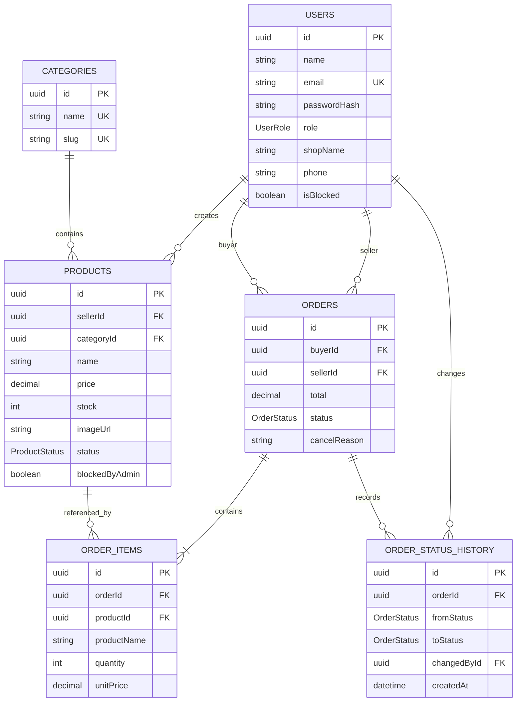

# HANDCRAFT — архитектура веб-платформы продажи изделий ручной работы

**Версия:** 2.1\
**Статус:** проектирование новой версии до начала реализации\
**Язык:** JavaScript\
**Стек:** React (Vite), Node.js, Express, PostgreSQL, Prisma\
**Валюта:** KZT

------------------------------------------------------------------------

## 1. Назначение проекта

HANDCRAFT — веб-платформа, на которой мастера размещают изделия ручной работы, а покупатели находят товары и оформляют заказы. Администратор управляет доступом пользователей и скрывает товары, нарушающие правила платформы.

**Главный сценарий:** мастер создаёт и публикует товар → покупатель находит его → добавляет в корзину → оформляет заказ → мастер обрабатывает заказ и меняет его статус.

Заказ оформляется без онлайн-оплаты. Покупатель указывает контакты и адрес, чтобы мастер мог связаться с ним и согласовать передачу товара. Старый прототип сохранён в отдельной ветке `old-prototype` и не переносится в новую версию как готовая реализация.

## 2. Пользователи и права доступа

Права проверяются сервером при каждом защищённом запросе.

| Возможность | Гость | Покупатель (`BUYER`) | Мастер (`SELLER`) | Администратор (`ADMIN`) |
|:---|:---|:---|:---|:---|
| Просмотр опубликованного каталога, поиск и категории | Да | Да | Да | Да |
| Оформление заказа | Нет | Да | Нет | Нет |
| Просмотр заказов | Нет | Только свои | Только свои | Все |
| Отмена заказа `NEW` | Нет | Только своего | Да, своего с причиной | Нет |
| Отмена заказа `CONFIRMED` | Нет | Нет | Да, своего с причиной | Нет |
| Создание товара | Нет | Нет | Да | Нет |
| Редактирование товара | Нет | Нет | Только своего, кроме `REMOVED` | Нет |
| Публикация / скрытие своего товара | Нет | Нет | Да, если нет блокировок | Нет |
| Блокировка пользователей и товаров | Нет | Нет | Нет | Да |

Гость просматривает каталог, категории и карточки товаров, ищет товары, регистрируется и входит. Покупатель управляет корзиной, оформляет заказы, видит только собственные заказы и может отменить собственный заказ `NEW`. Мастер управляет собственными товарами, видит свои заказы, меняет статусы по разрешённым переходам и может отменить свой заказ `NEW` или `CONFIRMED` с обязательной причиной. Администратор блокирует/разблокирует пользователей и скрывает товары, но не создаёт и не редактирует товары и не меняет статусы заказов в MVP.

Публичная регистрация разрешает только `BUYER` и `SELLER`. Роль `ADMIN` назначается отдельно.

## 3. MVP и пользовательские истории

### 3.1. Функции MVP

1.  Регистрация и вход покупателей и мастеров. Авторизация — JWT в `Authorization: Bearer <token>`.
2.  Каталог: категории и поиск по названию, без сортировки; пагинация — 20 товаров.
3.  Карточка товара: название, описание, цена, остаток, категория, мастер и одна фотография по URL.
4.  Кабинет мастера: создание, редактирование, публикация и скрытие собственных товаров. Фотография задаётся только ссылкой в `imageUrl`.
5.  Корзина и заказ: товары только одного мастера. При добавлении товара другого мастера покупателю предлагается оформить текущий заказ или очистить корзину.
6.  Заказы: покупатель видит свои и отменяет `NEW`; мастер видит свои, меняет статусы и может отменить `NEW` или `CONFIRMED` с причиной.
7.  Администрирование: блокировка/разблокировка пользователей и скрытие товаров. Категории задаются через `seed.js`.

Сервер повторно проверяет товар, цену, остаток, административную блокировку и состояние аккаунта мастера. Создание заказа, его позиций и уменьшение остатков выполняются в одной транзакции PostgreSQL.

**Новый товар создаётся со статусом `HIDDEN`.** После создания мастер проверяет карточку и нажимает «Опубликовать». Для публикации обязательна корректная ссылка `imageUrl`.

### 3.2. Функции после MVP

| Функция | Причина переноса |
|:---|:---|
| Корзина с товарами разных мастеров | Требует разбивки на несколько заказов и сложной транзакции |
| Загрузка фото файлами | Требует multipart, файлового хранилища, проверки формата и размера |
| Несколько фотографий | Требует управления набором изображений и порядком |
| Сортировка каталога | Для MVP достаточно категорий, поиска и пагинации |
| Управление категориями через админку | Используется фиксированный `seed.js` |
| Полноценная модерация и апелляции | Для MVP достаточно блокировки товара |
| Исправление статусов администратором | Не нужно для главного сценария |
| Автоотмена неподтверждённых заказов | Нужна фоновая задача |
| Оплата, отзывы, избранное, чат, уведомления | Отдельные функции после проверки основного сценария |

На будущее: если мастер не подтвердил заказ за три дня, система может отменить его и вернуть остаток. Фоновая задача не входит в MVP.

### 3.3. Пользовательские истории

| ID       | История                                             | Приоритет |
|:---------|:----------------------------------------------------|:----------|
| US-01    | Регистрация покупателя или мастера                  | MVP       |
| US-02    | Вход и получение профиля                            | MVP       |
| US-03    | Просмотр каталога и категорий                       | MVP       |
| US-04    | Поиск по названию                                   | MVP       |
| US-05    | Просмотр карточки товара                            | MVP       |
| US-06    | Корзина одного мастера и изменение количества       | MVP       |
| US-07    | Оформление заказа с контактами и адресом            | MVP       |
| US-08    | Просмотр своих заказов и статусов                   | MVP       |
| US-09    | Отмена собственного `NEW` покупателем               | MVP       |
| US-10    | Создание товара мастером с фото по URL              | MVP       |
| US-11    | Редактирование, публикация, скрытие и снятие товара | MVP       |
| US-12    | Просмотр, обработка и отмена своих заказов мастером | MVP       |
| US-13    | Блокировка и разблокировка пользователей            | MVP       |
| US-14    | Скрытие товаров администратором                     | MVP       |
| US-15–17 | Избранное, отзывы, переписка                        | После MVP |

## 4. Основные бизнес-правила

Все правила проверяются на сервере.

| ID | Правило |
|:---|:---|
| BR-01 | Email уникален. |
| BR-02 | Хранится хеш пароля, не пароль. |
| BR-03 | При регистрации нельзя назначить `ADMIN`. |
| BR-04 | Заблокированный пользователь не выполняет защищённые действия. |
| BR-05 | Мастер изменяет только собственные товары. |
| BR-06 | В каталоге только товары `PUBLISHED`, с `blockedByAdmin = false`, у мастеров с `isBlocked = false`. |
| BR-07 | Цена больше нуля; остаток — целое число не меньше нуля. |
| BR-08 | Товар связан с существующей категорией и пользователем `SELLER`. |
| BR-09 | Физического удаления нет: используется `REMOVED`; это окончательный статус без восстановления и редактирования. |
| BR-10 | При заказе сервер повторно проверяет статус, блокировки, цену и остаток. |
| BR-11 | Название и цена фиксируются в позиции заказа на момент покупки. |
| BR-12 | В MVP корзина содержит товары только одного мастера. |
| BR-13 | Заказ, позиции и уменьшение остатков выполняются в одной транзакции; при нехватке остатка — `409 Conflict`. |
| BR-14 | Покупатель видит только свои заказы и отменяет только свои `NEW`. |
| BR-15 | Мастер видит только заказы, где он продавец. |
| BR-16 | `COMPLETED` и `CANCELLED` — конечные статусы. |
| BR-17 | При отмене остаток возвращается только один раз; статус, возврат и история — одна транзакция. |
| BR-18 | Категории задаются через `seed.js`, CRUD API категорий нет. |
| BR-19 | Нельзя заблокировать последнего действующего администратора. |
| BR-20 | Телефон нормализуется к `+7XXXXXXXXXX`; `8 701...` преобразуется, некорректный номер отклоняется. |
| BR-21 | Мастер не может снять административную блокировку товара. |
| BR-22 | Мастер отменяет только свой `NEW` или `CONFIRMED`; причина отмены обязательна. |
| BR-23 | Товары заблокированного мастера скрыты; при оформлении заказа проверяется `seller.isBlocked = false`. |
| BR-24 | Новый товар создаётся `HIDDEN`; для появления в каталоге мастер отдельно нажимает «Опубликовать». |
| BR-25 | В MVP фото задаётся только URL в `imageUrl`; загрузки файлов нет. |

### 4.1. Статусы товара

| Статус | Значение |
|:---|:---|
| `PUBLISHED` | Опубликован мастером; виден, только если мастер и товар не заблокированы. |
| `HIDDEN` | Временно скрыт; мастер может редактировать и снова опубликовать. |
| `REMOVED` | Окончательно снят; запись остаётся для истории заказов, восстановление и редактирование запрещены. |

| Текущий статус | Новый статус | Разрешено мастеру |
|:---|:---|:---|
| `HIDDEN` | `PUBLISHED` | Да, если заполнен `imageUrl` и нет админской блокировки |
| `PUBLISHED` | `HIDDEN` | Да |
| `HIDDEN` | `REMOVED` | Да |
| `PUBLISHED` | `REMOVED` | Да |
| `REMOVED` | Любой другой | Нет |

`blockedByAdmin` — отдельное поле. При `true` товар не виден независимо от статуса. Мастер не меняет это поле; снять блокировку может только администратор. Редактирование описания блокировку не снимает. Если мастер `isBlocked = true`, все его товары исключаются из каталога. После разблокировки мастера товары `PUBLISHED` могут снова отображаться, если не заблокированы администратором.

### 4.2. Статусы заказа и переходы

| Статус       | Значение                                |
|:-------------|:----------------------------------------|
| `NEW`        | Создан, ожидает подтверждения мастером. |
| `CONFIRMED`  | Подтверждён мастером.                   |
| `PROCESSING` | Мастер готовит заказ.                   |
| `SHIPPED`    | Передан покупателю или в доставку.      |
| `COMPLETED`  | Выполнен.                               |
| `CANCELLED`  | Отменён.                                |

| Из           | В            | Кто                 | Условие                  |
|:-------------|:-------------|:--------------------|:-------------------------|
| `NEW`        | `CONFIRMED`  | Мастер этого заказа | Мастер не заблокирован   |
| `NEW`        | `CANCELLED`  | Покупатель-владелец | Только собственный заказ |
| `NEW`        | `CANCELLED`  | Мастер этого заказа | Обязательная причина     |
| `CONFIRMED`  | `PROCESSING` | Мастер этого заказа | Мастер не заблокирован   |
| `CONFIRMED`  | `CANCELLED`  | Мастер этого заказа | Обязательная причина     |
| `PROCESSING` | `SHIPPED`    | Мастер этого заказа | Мастер не заблокирован   |
| `SHIPPED`    | `COMPLETED`  | Мастер этого заказа | Мастер не заблокирован   |

Другие переходы запрещены. Покупатель не отменяет после `NEW`. Мастер не отменяет `PROCESSING`, `SHIPPED`, `COMPLETED` или `CANCELLED`. Административное исправление статусов не входит в MVP.

При отмене мастером непустая причина сохраняется в `orders.cancelReason`. При отмене покупателем причина необязательна. Каждое изменение записывается в `order_status_history`. При отмене сервер проверяет права и статус, переводит заказ в `CANCELLED`, возвращает остатки и записывает историю в одной транзакции. Повторная отмена не увеличивает остаток повторно.

## 5. База данных

PostgreSQL; Prisma — ORM. Идентификаторы UUID, денежные значения `Decimal @db.Decimal(12, 2)`, валюта KZT.

### 5.1. Таблицы

**`users` — пользователи**

| Поле                     | Тип                   | Назначение                 |
|:-------------------------|:----------------------|:---------------------------|
| `id`                     | UUID                  | Первичный ключ             |
| `name`                   | String                | Имя                        |
| `email`                  | String unique         | Уникальный email           |
| `passwordHash`           | String                | Хеш пароля                 |
| `role`                   | UserRole              | `BUYER`, `SELLER`, `ADMIN` |
| `shopName`               | String?               | Название мастерской        |
| `phone`                  | String?               | Нормализованный телефон    |
| `isBlocked`              | Boolean default false | Блокировка                 |
| `createdAt`, `updatedAt` | DateTime              | Даты                       |

**`categories` — категории**

| Поле          | Тип           | Назначение     |
|:--------------|:--------------|:---------------|
| `id`          | UUID          | Первичный ключ |
| `name`        | String unique | Название       |
| `slug`        | String unique | Имя для URL    |
| `description` | String?       | Описание       |
| `createdAt`   | DateTime      | Дата создания  |

Категории создаются через `seed.js`; API управления ими нет.

**`products` — товары**

| Поле | Тип | Назначение |
|:---|:---|:---|
| `id` | UUID | Первичный ключ |
| `sellerId` | UUID FK | Владелец `users.id` |
| `categoryId` | UUID FK | Категория |
| `name`, `description` | String | Название и описание |
| `price` | Decimal(12,2) | Цена |
| `stock` | Int | Остаток |
| `imageUrl` | String? | URL одной фотографии |
| `status` | ProductStatus default HIDDEN | `PUBLISHED`, `HIDDEN`, `REMOVED` |
| `blockedByAdmin` | Boolean default false | Админская блокировка |
| `createdAt`, `updatedAt` | DateTime | Даты |

Отдельная таблица изображений и каталог `uploads/` в MVP не нужны: используется только URL.

**`orders` — заказы**

Один заказ относится к одному покупателю и одному мастеру.

| Поле | Тип | Назначение |
|:---|:---|:---|
| `id` | UUID | Первичный ключ |
| `buyerId`, `sellerId` | UUID FK | Покупатель и мастер |
| `total` | Decimal(12,2) | Итоговая сумма |
| `status` | OrderStatus default NEW | Текущий статус |
| `contactName`, `contactPhone`, `deliveryAddress` | String | Контакты и адрес на момент заказа |
| `comment` | String? | Комментарий покупателя |
| `cancelReason` | String? | Причина отмены мастером |
| `createdAt`, `updatedAt` | DateTime | Даты |

**`order_items` — позиции заказа**

| Поле          | Тип               | Назначение                 |
|:--------------|:------------------|:---------------------------|
| `id`          | UUID              | Первичный ключ             |
| `orderId`     | UUID FK           | Заказ                      |
| `productId`   | UUID FK, NOT NULL | Ссылка на товар            |
| `productName` | String            | Название на момент покупки |
| `quantity`    | Int               | Количество                 |
| `unitPrice`   | Decimal(12,2)     | Цена на момент покупки     |

Товары не удаляются физически, поэтому `productId` обязателен. Название и цена сохраняются для неизменности истории покупки.

**`order_status_history` — история статусов**

| Поле          | Тип          | Назначение                           |
|:--------------|:-------------|:-------------------------------------|
| `id`          | UUID         | Первичный ключ                       |
| `orderId`     | UUID FK      | Заказ                                |
| `fromStatus`  | OrderStatus? | Предыдущий статус; NULL при создании |
| `toStatus`    | OrderStatus  | Новый статус                         |
| `changedById` | UUID FK      | Пользователь, выполнивший переход    |
| `createdAt`   | DateTime     | Время изменения                      |

При создании заказа записывается `NULL → NEW`. Каждое изменение статуса создаёт отдельную запись. Причина отмены хранится в `orders.cancelReason`.

### 5.2. Перечисления и связи

- `UserRole`: `BUYER`, `SELLER`, `ADMIN`.
- `ProductStatus`: `PUBLISHED`, `HIDDEN`, `REMOVED`.
- `OrderStatus`: `NEW`, `CONFIRMED`, `PROCESSING`, `SHIPPED`, `COMPLETED`, `CANCELLED`.
- `users` 1:N `products` по `sellerId`.
- `categories` 1:N `products`.
- `users` 1:N `orders` по `buyerId` и отдельно по `sellerId`.
- `orders` 1:N `order_items`; `products` 1:N `order_items`.
- `orders` 1:N `order_status_history`; `users` 1:N `order_status_history` по `changedById`.

### 5.3. ER-диаграмма



Корзина MVP хранится на клиенте. При оформлении сервер заново получает актуальные значения из БД и не доверяет цене, названию, продавцу или остатку от клиента.

## 6. API — взаимодействие клиента и сервера

Общий префикс — `/api`. Данные передаются в JSON. Защищённые запросы содержат `Authorization: Bearer <JWT>`.

### 6.1. Авторизация

| Метод и endpoint | Доступ | Запрос | Ответ | История |
|:---|:---|:---|:---|:---|
| `POST /api/auth/register` | Гость | Имя, email, пароль, роль BUYER/SELLER | `201`: пользователь и JWT | US-01 |
| `POST /api/auth/login` | Гость | Email и пароль | `200`: пользователь и JWT | US-02 |
| `GET /api/auth/me` | Авторизованный | Без тела | `200`: профиль без пароля | US-02 |

Пароль хешируется. `passwordHash` и пароль не возвращаются. Выход в MVP выполняется удалением JWT на клиенте.

### 6.2. Каталог

| Метод и endpoint | Доступ | Запрос | Ответ | История |
|:---|:---|:---|:---|:---|
| `GET /api/categories` | Все | Без параметров | `200`: категории | US-03 |
| `GET /api/products` | Все | `q`, `category`, `page`, `limit` | `200`: список и пагинация | US-03, US-04 |
| `GET /api/products/:id` | Все, с проверкой видимости | ID товара | `200`: карточка товара | US-05 |

`q` — поиск по названию; `category` — категория; `page` — номер страницы; `limit` — максимум 20. Сортировки нет. Каталог и публичная карточка возвращают только товары `PUBLISHED`, не заблокированные администратором и принадлежащие незаблокированному мастеру.

### 6.3. Товары мастера

| Метод и endpoint | Доступ | Запрос | Ответ | История |
|:---|:---|:---|:---|:---|
| `GET /api/seller/products` | Мастер | Без тела | `200`: товары мастера | US-11 |
| `POST /api/seller/products` | Мастер | Поля товара, включая `imageUrl` | `201`: товар `HIDDEN` | US-10 |
| `PUT /api/seller/products/:id` | Мастер-владелец | Поля товара | `200`: обновлённый товар | US-11 |
| `PATCH /api/seller/products/:id/status` | Мастер-владелец | `PUBLISHED`, `HIDDEN` или `REMOVED` | `200`: обновлённый товар | US-11 |

Новый товар создаётся `HIDDEN`. Для публикации требуется заполненный `imageUrl` и отдельное действие мастера. Мастер не может опубликовать товар с `blockedByAdmin = true`. `REMOVED` нельзя редактировать или восстановить. Endpoint загрузки файла отсутствует.

### 6.4. Администрирование

| Метод и endpoint | Доступ | Запрос | Ответ | История |
|:---|:---|:---|:---|:---|
| `GET /api/admin/users` | Администратор | Пагинация | `200`: пользователи без паролей | US-13 |
| `PATCH /api/admin/users/:id/block` | Администратор | `{ "isBlocked":true }` или `false` | `200`: состояние блокировки | US-13 |
| `GET /api/admin/products` | Администратор | Пагинация | `200`: товары | US-14 |
| `PATCH /api/admin/products/:id/moderation` | Администратор | `{ "blockedByAdmin":true }` или `false` | `200`: товар | US-14 |

Администратор не создаёт и не редактирует товары. API управления категориями отсутствует. При блокировке мастера его товары скрываются из публичного каталога без удаления записей.

### 6.5. Корзина и заказы

| Метод и endpoint | Доступ | Запрос | Ответ | История |
|:---|:---|:---|:---|:---|
| `POST /api/orders` | Покупатель | `productId`, `quantity`, контакты и адрес | `201`: заказ `NEW` | US-06, US-07 |
| `GET /api/orders/my` | Покупатель | Пагинация | `200`: свои заказы | US-08 |
| `GET /api/seller/orders` | Мастер | Пагинация | `200`: заказы мастера | US-12 |
| `GET /api/orders/:id` | Покупатель-владелец или мастер заказа | ID заказа | `200`: заказ и позиции | US-08, US-12 |
| `PATCH /api/orders/:id/status` | Мастер заказа | Новый разрешённый статус | `200`: обновлённый заказ | US-12 |
| `POST /api/orders/:id/cancel` | Покупатель-владелец или мастер заказа | Мастер: `{ "reason":"..." }`; покупатель: необязательно | `200`: заказ `CANCELLED` | US-09, US-12 |

Сервер принимает только ID товара, количество и контактные данные. Название, цена, продавец и сумма рассчитываются сервером. Все товары должны принадлежать одному мастеру, иначе `400`. Сервер проверяет, что мастер не заблокирован.

Покупатель отменяет только свой `NEW`. Мастер отменяет только свой `NEW` или `CONFIRMED`, обязательно передавая непустую причину. После `PROCESSING` отмена запрещена. Успешная отмена одной транзакцией меняет статус, сохраняет причину, возвращает остатки и записывает историю. Повторный запрос не возвращает остаток повторно.

### 6.6. Примеры API

**Регистрация — `POST /api/auth/register`, HTTP 201**

``` json
{
  "user": { "id": "uuid", "name": "Анна", "email": "anna@example.com", "role": "BUYER" },
  "token": "jwt-token"
}
```

**Каталог — `GET /api/products?page=1&limit=20`, HTTP 200**

``` json
{
  "items": [{ "id": "uuid", "name": "Керамическая чашка", "price": "5000.00", "stock": 3, "imageUrl": "https://example.com/cup.jpg" }],
  "page": 1,
  "limit": 20,
  "total": 1,
  "pages": 1
}
```

**Создание товара — `POST /api/seller/products`, HTTP 201**

``` json
{
  "id": "uuid",
  "name": "Керамическая чашка",
  "price": "5000.00",
  "stock": 3,
  "status": "HIDDEN",
  "blockedByAdmin": false,
  "imageUrl": "https://example.com/cup.jpg"
}
```

**Оформление заказа — `POST /api/orders`, HTTP 201**

``` json
{
  "id": "uuid",
  "status": "NEW",
  "total": "10000.00",
  "contactName": "Анна",
  "contactPhone": "+77011234567",
  "deliveryAddress": "Алматы, пример адреса",
  "items": [{ "productId": "uuid", "productName": "Керамическая чашка", "quantity": 2, "unitPrice": "5000.00" }]
}
```

**Отмена мастером — `POST /api/orders/:id/cancel`, HTTP 200**

Запрос: `{ "reason": "Закончился материал для изготовления" }`

Ответ:

``` json
{
  "id": "uuid",
  "status": "CANCELLED",
  "cancelReason": "Закончился материал для изготовления"
}
```

**Недостаточный остаток — HTTP 409**

``` json
{
  "error": { "code": "INSUFFICIENT_STOCK", "message": "Недостаточно товара на складе" }
}
```

### 6.7. Общие ошибки API

| HTTP | Значение | Пример |
|:---|:---|:---|
| `400` | Неверные данные | Некорректное поле или товары разных мастеров |
| `401` | Нет авторизации | JWT отсутствует или недействителен |
| `403` | Нет прав | Изменение чужого товара или действие заблокированного пользователя |
| `404` | Не найдено | Товар или заказ отсутствует |
| `409` | Конфликт | Недостаточный остаток или недопустимый переход |
| `500` | Ошибка сервера | Непредвиденная ошибка |

## 7. Архитектура приложения и структура проекта

### 7.1. Карта страниц и URL

| Страница | URL | Доступ | Назначение |
|:---|:---|:---|:---|
| Каталог | `/` | Все | Опубликованные товары |
| Категория | `/categories/:slug` | Все | Товары категории |
| Карточка товара | `/products/:id` | Все с проверкой видимости | Информация о товаре |
| Регистрация | `/register` | Гость | Создание аккаунта |
| Вход | `/login` | Гость | Авторизация |
| Корзина | `/cart` | Покупатель | Просмотр корзины |
| Оформление | `/checkout` | Покупатель | Контакты и заказ |
| Мои заказы | `/account/orders` | Покупатель | История заказов |
| Заказ покупателя | `/account/orders/:id` | Покупатель-владелец | Детали заказа |
| Товары мастера | `/seller/products` | Мастер | Свои товары |
| Создание товара | `/seller/products/new` | Мастер | Форма товара |
| Редактирование товара | `/seller/products/:id/edit` | Мастер-владелец | Изменение товара |
| Заказы мастера | `/seller/orders` | Мастер | Свои заказы |
| Заказ мастера | `/seller/orders/:id` | Мастер заказа | Обработка или отмена |
| Пользователи | `/admin/users` | Администратор | Блокировка пользователей |
| Товары | `/admin/products` | Администратор | Просмотр и скрытие |

### 7.2. Frontend

React отвечает за страницы, компоненты, формы и API. Vite используется для разработки и сборки. Клиент передаёт JWT в `Authorization`. Скрытие элементов интерфейса не заменяет проверку прав на сервере.

### 7.3. Backend

Node.js запускает сервер, Express обрабатывает HTTP-запросы, Prisma взаимодействует с PostgreSQL. Путь запроса: `routes → middleware → controllers → services → Prisma → PostgreSQL`.

- `routes` — URL, HTTP-метод и middleware;
- `middleware` — JWT, роль и блокировка пользователя;
- `controllers` — приём запроса и HTTP-ответ;
- `services` — бизнес-правила, заказы, транзакции и остатки;
- `Prisma` — запросы и транзакции к PostgreSQL.

### 7.4. Структура каталогов

```text
HANDCRAFT/
├── client/
│   ├── src/components/
│   ├── src/pages/
│   ├── src/services/
│   ├── src/hooks/
│   ├── src/context/
│   ├── src/App.jsx
│   ├── index.html
│   └── package.json
├── server/
│   ├── src/routes/
│   ├── src/controllers/
│   ├── src/services/
│   ├── src/middleware/
│   ├── src/validators/
│   ├── src/database/
│   ├── src/app.js
│   ├── prisma/schema.prisma
│   ├── prisma/seed.js
│   └── package.json
├── docs/architecture.md
├── docs/competitors.md
├── docs/spec.md
├── .env.example
├── .gitignore
└── README.md
```

В MVP нет `uploads/`, так как изображения задаются только URL. Структура может уточняться при реализации, но разделение frontend, backend и серверных слоёв сохраняется.

## 8. Безопасность и проверка данных

1.  Пароли хранятся только в виде хеша (bcrypt/bcryptjs).
2.  Авторизация выполняется сервером через JWT в `Authorization`.
3.  Регистрация разрешает только `BUYER` и `SELLER`; `ADMIN` нельзя назначить клиентским запросом.
4.  Защищённые маршруты используют middleware авторизации и проверки роли.
5.  Заблокированный пользователь не выполняет защищённые действия.
6.  Сервер проверяет владельца товара или заказа.
7.  В каталоге и при оформлении заказа проверяется блокировка мастера.
8.  Входные данные проверяются до операций с БД.
9.  Секреты и строка подключения хранятся в `.env`, который не добавляется в Git.
10. Для Express настраиваются безопасные HTTP-заголовки, rate limit и CORS.
11. Для `imageUrl` проверяется допустимый URL; загрузки файлов нет.
12. Телефон нормализуется к `+7XXXXXXXXXX`.
13. Изменение остатков и отмена заказа выполняются транзакционно.
14. JWT имеет ограниченный срок действия; при выходе клиент удаляет токен.

JWT передаётся в заголовке, поэтому cookie/CSRF-схема в MVP не используется.

## 9. Ключевые технические сценарии

### 9.1. Два покупателя заказывают последний товар

При остатке 1 два запроса выполняют проверку и уменьшение внутри транзакции. Условное обновление остатка позволяет только одной операции зарезервировать последнюю единицу. Второй запрос не создаёт заказ и получает `409 Conflict`. Это обеспечивают BR-10 и BR-13.

### 9.2. Администратор скрыл товар

Администратор устанавливает `blockedByAdmin = true`. Товар исчезает из каталога. Мастер не может сбросить это поле; редактирование описания не снимает блокировку.

### 9.3. Администратор заблокировал мастера

При `users.isBlocked = true` все товары мастера исключаются из каталога. Мастер не выполняет защищённые действия. Проверка блокировки владельца выполняется и при оформлении заказа. Товары и история заказов не удаляются.

### 9.4. Мастер не может выполнить заказ

Мастер открывает заказ `NEW` или `CONFIRMED`, выбирает отмену и указывает причину. Сервер проверяет владельца и статус, затем одной транзакцией устанавливает `CANCELLED`, сохраняет причину, возвращает остаток и записывает историю. Повторная отмена не возвращает остаток повторно.

### 9.5. Почему корзина ограничена одним мастером

Один заказ относится к одному продавцу. Не нужно делить корзину на несколько заказов и обрабатывать частичный успех для разных продавцов. После MVP позиции можно группировать по `sellerId` и создавать несколько заказов в общей транзакции.

### 9.6. Зачем хранить название и цену в `order_items`

Название и цена могут измениться после покупки. `productName` и `unitPrice` сохраняют значения на момент оформления, поэтому история заказа остаётся корректной.

## 10. Критерии готовности MVP

- Покупатель и мастер могут зарегистрироваться и войти.
- Гость видит категории и опубликованный каталог, может искать по названию.
- Каталог исключает скрытые товары, товары с `blockedByAdmin = true` и товары заблокированных мастеров.
- Мастер создаёт товар `HIDDEN` с одной фотографией по URL и отдельно публикует его.
- `REMOVED` нельзя восстановить или редактировать.
- Покупатель оформляет заказ с товарами одного мастера.
- Сервер проверяет цены, остатки и блокировки.
- При одновременной покупке последней единицы остаток не становится отрицательным; второй запрос получает `409`.
- Покупатель видит свои заказы и отменяет `NEW`.
- Мастер меняет разрешённые статусы и отменяет `NEW` или `CONFIRMED` с причиной.
- При отмене остаток возвращается ровно один раз.
- История статусов сохраняет пользователя, дату и переход.
- Администратор блокирует пользователей и товары.

## 11. Возможное развитие после MVP

После проверки основного сценария можно добавить корзину с товарами разных мастеров, загрузку файлов и несколько фотографий, сортировку, управление категориями, расширенную модерацию, административное исправление статусов, избранное, отзывы, чат, уведомления и онлайн-оплату. Также можно реализовать автоотмену заказов, не подтверждённых за три дня, с возвратом остатка через фоновую задачу.

## 12. Вопросы для защиты

**1. Главный сценарий?** Мастер публикует товар, покупатель находит его, добавляет в корзину и оформляет заказ, мастер обрабатывает заказ.

**2. Два покупателя заказывают последнюю вазу?** Транзакция резервирует единицу только для одного запроса. Второй получает `409 Conflict`, заказ не создаётся.

**3. Почему корзина одного мастера?** Один заказ относится к одному продавцу; после MVP корзину можно группировать по `sellerId`.

**4. Администратор скрыл товар. Может ли мастер вернуть его?** Нет. `blockedByAdmin = true` может снять только администратор; редактирование описания ничего не меняет.

**5. Зачем хранить название и цену в `order_items`?** Чтобы сохранить данные на момент покупки, даже если карточка товара изменится.

**6. Почему заказ и остатки меняются в транзакции?** Чтобы не возникло заказа без списания остатка или списания без заказа.

**7. Мастер не может выполнить заказ. Что делает?** Отменяет свой `NEW` или `CONFIRMED`, указывает причину; система возвращает остаток один раз и сохраняет историю.

**8. Чем отличаются `HIDDEN` и `REMOVED`?** `HIDDEN` временный и обратимый; `REMOVED` окончательный и необратимый.

**9. Что при блокировке мастера?** Его товары скрываются из каталога, а защищённые действия запрещаются; блокировка проверяется и при оформлении заказа.

## Заключение

Архитектура HANDCRAFT описывает MVP маркетплейса изделий ручной работы на React, Node.js, Express, PostgreSQL и Prisma. Определены роли, семь функций MVP, пользовательские истории, бизнес-правила, статусы товаров и заказов, структура БД, ER-диаграмма, API, карта страниц, безопасность и критерии готовности.

Главный критерий готовности — покупатель оформляет заказ на опубликованный товар, а соответствующий мастер видит и обрабатывает его. Если мастер не может выполнить заказ до начала обработки, он отменяет его с причиной, а остаток возвращается безопасно и только один раз.
